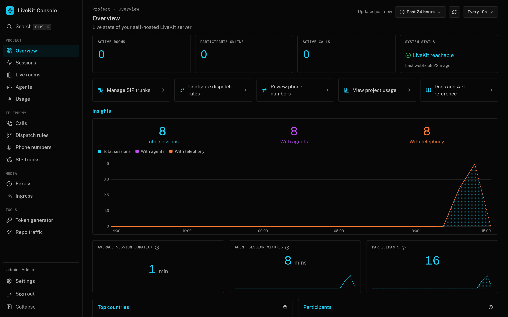
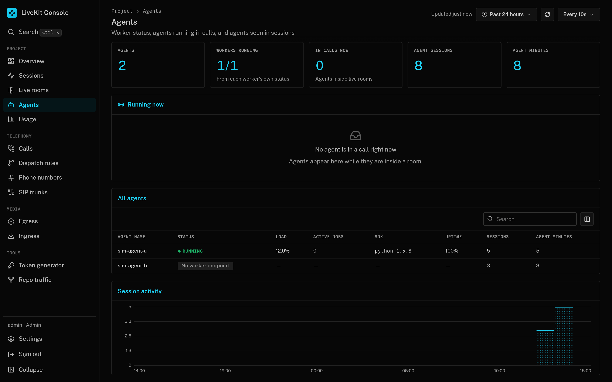
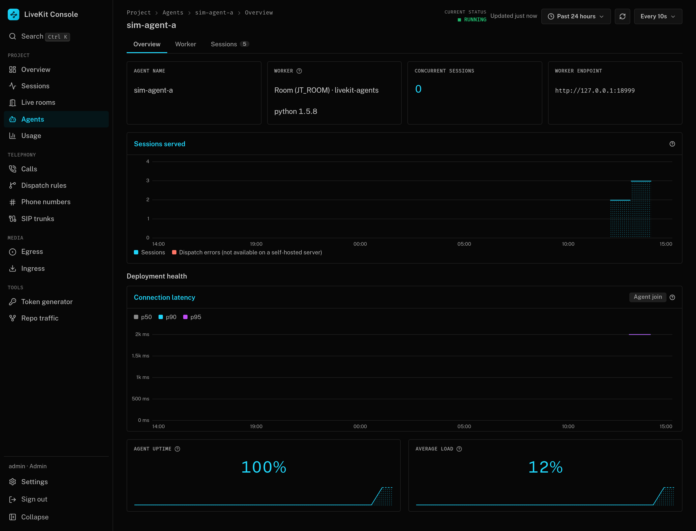
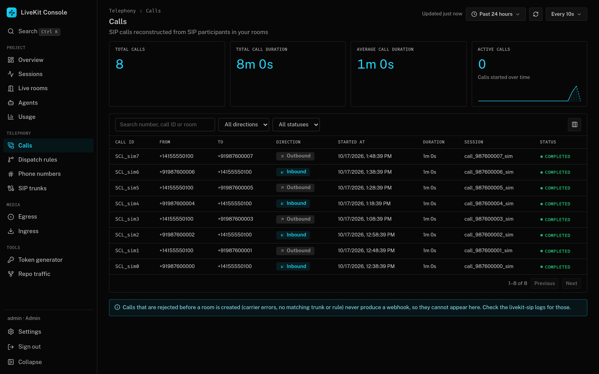
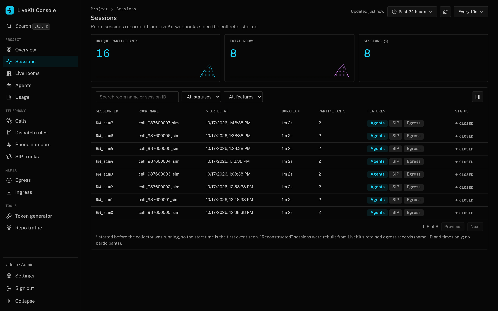

# LiveKit Console

A self-hostable admin console for a **self-hosted LiveKit** server, modeled on the LiveKit Cloud dashboard
(which has no open-source equivalent). React + Vite + TypeScript frontend; a small Express backend that holds the
API key/secret so the browser never sees them, receives LiveKit webhooks and stores history in SQLite.

## Documentation
- [Getting started](docs/getting-started.md): configure, run, enable webhooks and agent status
- [Features](docs/features.md): every page and what it shows
- [Configuration](docs/configuration.md): all environment variables
- [Deployment](docs/deployment.md): deploy to a VM with HTTPS and an IP allowlist
- [Cloud coverage and validation](docs/parity-and-validation.md): supported capabilities and remaining acceptance checks

## Screenshots
Taken from a demo instance with simulated data (`server/scripts/simulate-webhooks.ts`).

## What it covers
| Area | Source |
|---|---|
| Live rooms, participants, agent dispatch, token generator | LiveKit server APIs (live) |
| SIP trunks (inbound/outbound), dispatch rules (agent dispatch, trunk/number routing), phone numbers view | LiveKit SIP admin API, with create/edit forms and a JSON editor |
| Egress (start/stop/inspect), ingress (create/delete) | LiveKit egress/ingress API |
| Sessions, participants, events, calls, usage, overview insights | Webhooks stored in SQLite (history starts when the collector starts) |

Not available on a self-hosted server (so not faked): per-session bandwidth/latency analytics, agent observability,
PCAP/codec/SIP response per call, calls rejected before a room is created, number purchasing, billing.

## Agents
Agent status comes from the workers themselves, not from test jobs. Every LiveKit Agents worker serves a small status
server (port 8081 by default: `GET /` health, `GET /worker` name, job type, load, active jobs, SDK version). Set
`AGENT_WORKER_URLS` (comma-separated base URLs) and the console polls them every 10s, so a running worker shows as
**Running** and a stopped one as **Dead**, with its last ping and last healthy time. Each agent's page has an Overview
(sessions served, join latency, uptime, load), a **Worker** tab and a Sessions tab. The worker ID (`AW_...`) is not exposed
by the status server, so it only shows if a worker reports one.

## Repo traffic
GitHub keeps only 14 days of clone and view counts. Set `GITHUB_TOKEN` (push access to the repo) and optionally `GITHUB_REPO`
and the console copies the daily counts into its database every hour; **Tools → Repo traffic** charts them over any range.

## Access control
Sign in with the admin from `.env` (always works, as a fallback), then add teammates under **Settings → Team members**.
Roles: **Admin** (full access) and **Viewer** (read everything, change nothing; enforced on the server). Passwords are
stored as scrypt hashes; role changes and removals apply on the person's next request.

## Run locally
    cp .env.example .env     # LIVEKIT_URL, API key/secret, ADMIN_USER, ADMIN_PASSWORD, SESSION_SECRET (optional: SIP_URI)
    npm install
    npm run dev              # web :5173 (proxies /api), server :8080

## Production
    npm run build && npm start
    # or
    docker build -t livekit-console . && docker run --env-file .env -p 8080:8080 -v console-data:/data -e DB_PATH=/data/console.db livekit-console

Put it behind HTTPS (the session cookie is `Secure` only for HTTPS requests; `trust proxy` is on).

## Webhooks
Point LiveKit at `http://<console>/webhook` (signed with your API key, verified by the console):

    webhook:
      api_key: <key name from keys:>
      urls: [http://127.0.0.1:8090/webhook]

## Deploy to a VM
    cp .env.deploy.example .env.deploy   # DEPLOY_HOST, LIVEKIT_CONFIG, CONSOLE_HOST, ALLOWED_IPS, ...
    ./deploy.sh --sync-env               # first deploy: sync code + .env, build, run
    ./deploy.sh                          # later deploys
    ./deploy.sh webhook                  # add the webhook block to LiveKit's config (+ restart if no rooms are active)
    ./deploy.sh https                    # nginx + Let's Encrypt, limited to ALLOWED_IPS

The container binds to `127.0.0.1` on the VM; reach it through an SSH tunnel or the HTTPS step above.
`scripts/simulate-webhooks.ts` and `scripts/check-livekit.ts` help with testing and verifying credentials.

## Contributing
See [CONTRIBUTING.md](CONTRIBUTING.md), the [Code of Conduct](CODE_OF_CONDUCT.md) and [SECURITY.md](SECURITY.md). The project is [MIT licensed](LICENSE).

Ask questions in [Discussions](https://github.com/unpod-ai/livekit-console/discussions), report bugs through the
[issue chooser](https://github.com/unpod-ai/livekit-console/issues/new/choose), or browse the [roadmap](ROADMAP.md)
and [changelog](CHANGELOG.md).

## Star history

